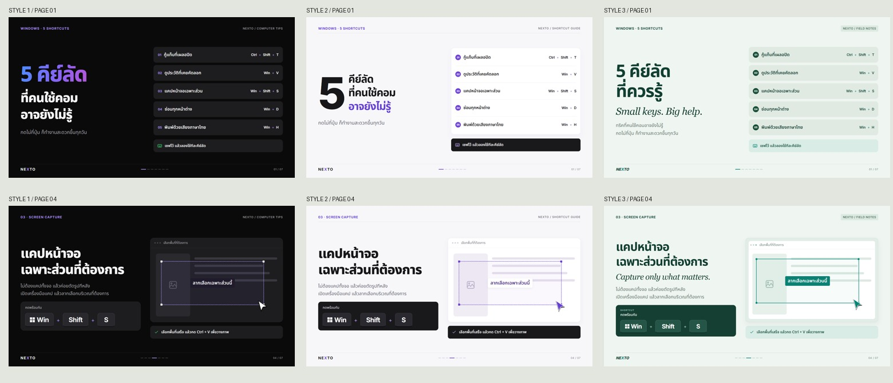

# Thai HTML infographics

งานจาก `sample` จำนวน 7 หน้า ออกแบบใหม่เป็น HTML แนวนอน 16:9 ขนาด 1920 × 1080 ครบ 3 สไตล์ ใช้ Noto Sans Thai และฟอนต์ที่รวมไว้ในโปรเจกต์

## เปิดดูงาน

ดาวน์โหลด repository หรือ clone แล้วเปิด [หน้าเปรียบเทียบ](outputs/16x9/index.html) ในเบราว์เซอร์ เปิดได้โดยไม่ต้องติดตั้งโปรแกรมเพิ่มเติมและไม่ต้องใช้อินเทอร์เน็ต

- [สไตล์ 1: ดำ ม่วง เขียว](outputs/16x9/style-1/index.html)
- [สไตล์ 2: ขาว ดำ ม่วง](outputs/16x9/style-2/index.html)
- [สไตล์ 3: มิ้นต์และหัวข้ออังกฤษตัวเอียง](outputs/16x9/style-3/index.html)

แต่ละสไตล์มี HTML ที่แก้ไขได้ 7 หน้า, PNG 7 ภาพ, `all.html` สำหรับดูทั้งชุด และ `collection.pdf` จำนวน 7 หน้า ตัวอักษรและภาพประกอบสร้างด้วย HTML/CSS/SVG



ไฟล์ต้นฉบับอยู่ใน `sample/` และ [source-map.json](source-map.json) บันทึกว่าต้นฉบับแต่ละภาพตรงกับ HTML หน้าใด พร้อมค่า SHA-256 ของต้นฉบับ

หน้าแคปหน้าจอแก้คีย์ลัดจาก Ctrl + Shift + S ในต้นฉบับเป็น Win + Shift + S ตาม [Microsoft Support](https://support.microsoft.com/en-us/windows/apps/use-snipping-tool-to-capture-screenshots)

## ใช้สกิลบนเครื่องอื่น

สกิลทั้งหมดอยู่ใน [skills/thai-html-infographics](skills/thai-html-infographics/SKILL.md) รองรับทั้ง 4:5 และ 16:9 ครบ 3 สไตล์ พร้อมแม่แบบ ภาพตัวอย่าง ฟอนต์ และเครื่องมือส่งออก

หลังดาวน์โหลดโปรเจกต์ ให้เปิดเทอร์มินัลที่โฟลเดอร์นี้แล้วรัน:

```text
python scripts/install-skill.py
```

ตัวติดตั้งคัดลอกสกิลไปยัง `$CODEX_HOME/skills` ถ้าตั้งค่าไว้ หรือ `~/.codex/skills` ตามค่าเริ่มต้น ถ้ามีสกิลชื่อเดียวกันอยู่แล้ว จะหยุดเพื่อรักษาไฟล์เดิม คุณสามารถคัดลอกโฟลเดอร์สกิลเองได้เช่นกัน จากนั้นเปิดแชตใหม่ใน Codex และใช้คำสั่ง เช่น:

```text
ใช้ $thai-html-infographics ทำไฟล์จาก sample เป็น 16:9 ทั้ง 3 สไตล์
```

## แก้ไขและส่งออกใหม่

แก้ HTML/CSS ใน `outputs/16x9/style-1`, `style-2` หรือ `style-3` แล้วส่งออก PNG/PDF ใหม่ด้วย Node.js และ Playwright:

```text
npm install
npx playwright install chromium
npm run render
```

คำสั่งส่งออกอัปเดต PNG, PDF และรายงานตรวจข้อความล้น โดยเก็บ HTML เดิมไว้ หากแก้ HTML รายหน้า ให้แก้ `all.html` ให้ตรงกันด้วย PDF จะประกอบจาก HTML รายหน้าโดยตรง

ตรวจความครบถ้วนของไฟล์และขนาดภาพได้ด้วย:

```text
python scripts/check-output.py
```

สร้างชุดใหม่จากแม่แบบโดยเลือกสไตล์และสัดส่วนได้แยกกัน:

```text
python skills/thai-html-infographics/scripts/start_project.py --style 2 --aspect 16:9 --output new-design
```

แม่แบบมีเนื้อหาตัวอย่าง ต้องปรับให้ตรงกับโจทย์ใหม่ก่อนส่งออก งานชุดนี้ใช้เนื้อหาที่ตรงกับ sample อยู่แล้ว

## ฟอนต์และต้นฉบับ

Noto Sans Thai และ Inter รวมไฟล์และสัญญาอนุญาต OFL ไว้ในโฟลเดอร์ฟอนต์ Georgia ใช้สำหรับหัวข้อภาษาอังกฤษของสไตล์ 3 ผ่านฟอนต์ของระบบ โดยมีฟอนต์สำรองไว้ งานต้นฉบับและแบรนด์ NEXTO มาจากไฟล์ที่ผู้ใช้ให้มา
